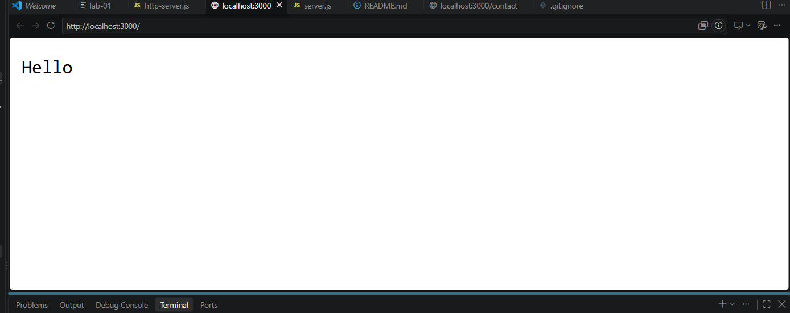
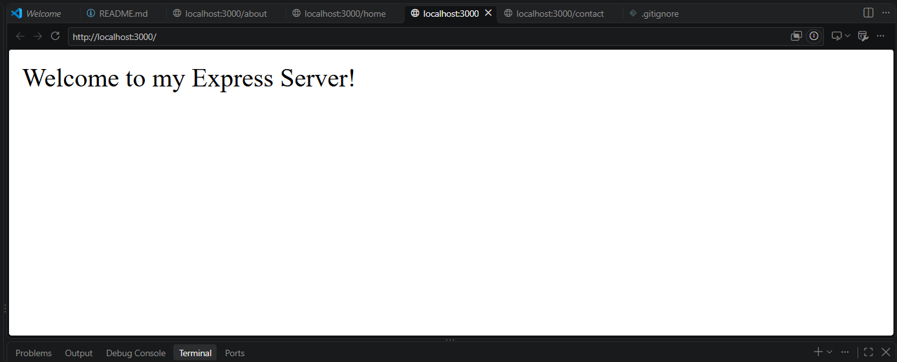
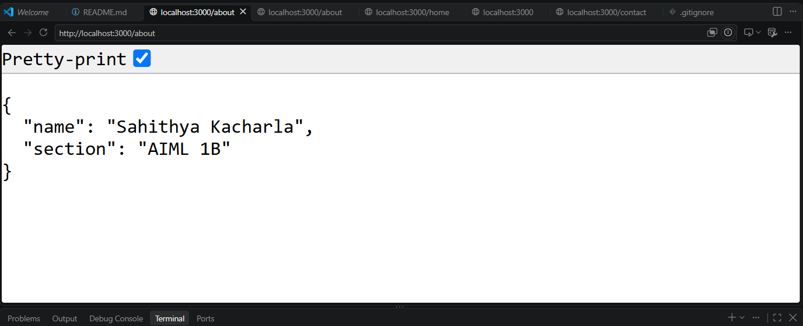
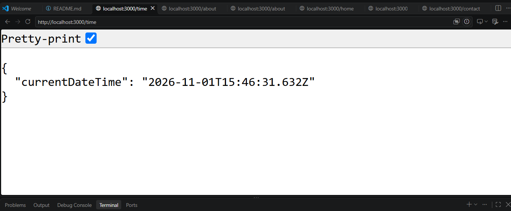
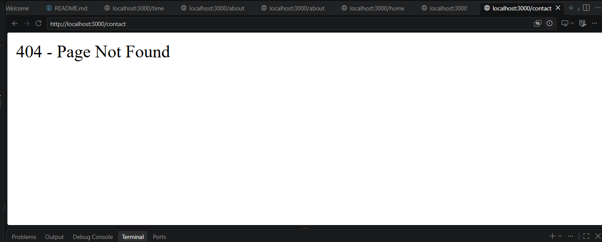

# Lab 1: Node.js and Express Server

## Student Details

* **Name:** Sahithya Kacharla
* **Registration Number:** YOUR REGISTRATION NUMBER
* **Section:** YOUR SECTION
* **Course:** Backend Development Fundamentals
* **Lab:** 01

## Objective

To understand the fundamentals of Node.js and Express.js by creating an HTTP server, implementing different routes, handling requests and responses, and managing HTTP status codes.

## Technologies Used

* Node.js
* Express.js
* JavaScript
* Visual Studio Code

## Project Structure

```text
lab-01/
├── screenshots/
├── node_modules/
├── http-server.js
├── server.js
├── package.json
├── package-lock.json
├── .gitignore
└── README.md
```

## Installation and Execution

### 1. Clone the repository

```bash
git clone YOUR_GITHUB_REPOSITORY_URL
```

### 2. Navigate to the project folder

```bash
cd lab-01
```

### 3. Install dependencies

```bash
npm install
```

### 4. Run the HTTP server

```bash
node http-server.js
```

### 5. Run the Express server

```bash
node server.js
```

Open the following address in your browser:

`http://localhost:3000`

## Implemented Endpoints

| HTTP Method | Endpoint   | Description                              | Status Code |
| ----------- | ---------- | ---------------------------------------- | ----------- |
| GET         | `/`        | Displays welcome message                 | 200         |
| GET         | `/about`   | Returns student name and section in JSON | 200         |
| GET         | `/time`    | Returns current date and time            | 200         |
| GET         | `/contact` | Displays 404 error for unknown routes    | 404         |

## Screenshots

### 1. HTTP Server

![HTTP Server]

### 2. Home Route

![Home Route]

### 3. About Route

![About Route]

### 4. Time Route

![Time Route]

### 5. 404 Error Handling

![404 Error]

## Learning Outcomes

* Understood the fundamentals of Node.js.
* Learned to create an HTTP server using the built-in HTTP module.
* Installed and used Express.js.
* Implemented GET routes.
* Understood request and response objects.
* Learned to handle unknown routes using HTTP 404.
* Verified HTTP status codes.

## Problems Faced and Solutions

* Initially faced a folder structure issue, which was resolved by organizing the project files correctly.
* Successfully configured the Node.js environment and installed Express.js.
* Tested all endpoints and verified their HTTP status codes.

## Deployment

Live URL: To be added after deployment.

---

**Lab 1 completed successfully.**
