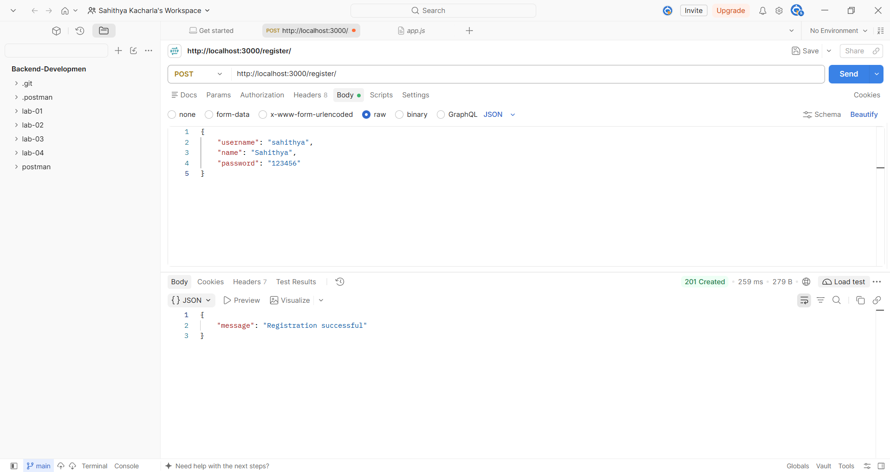
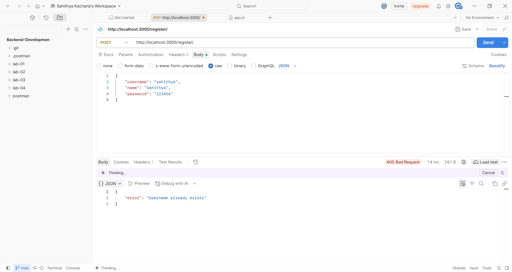
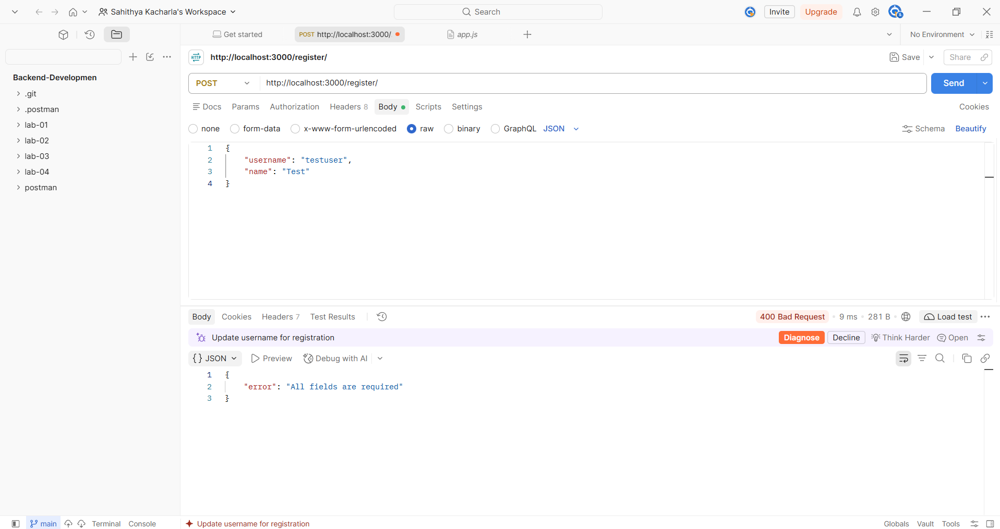
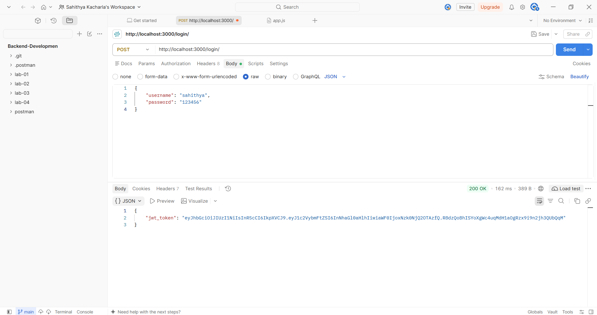
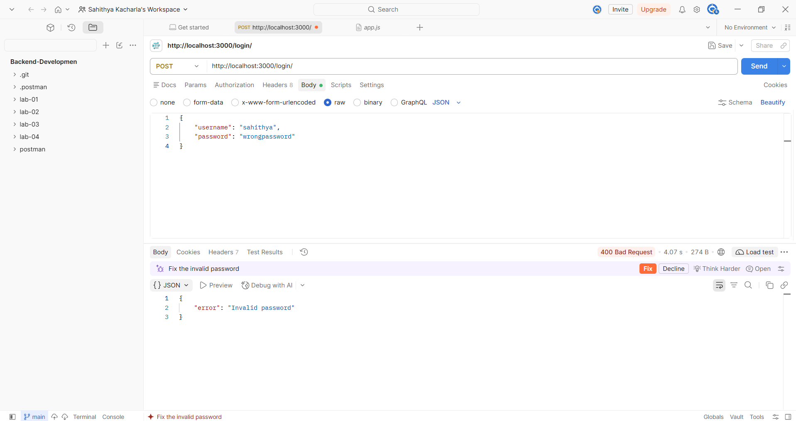
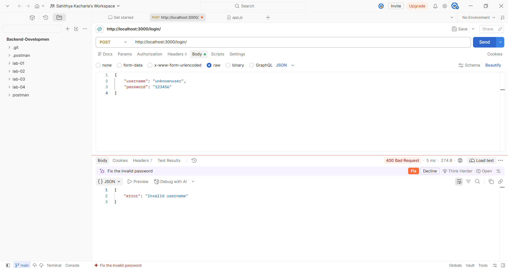
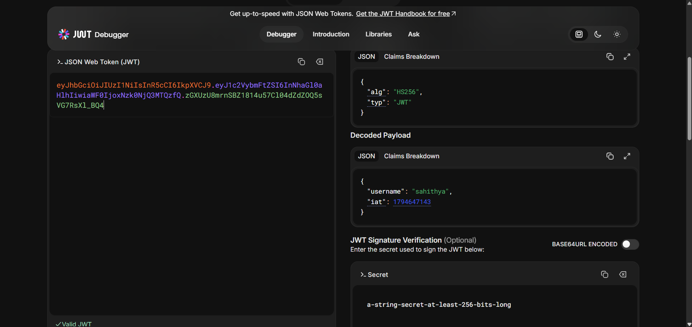

# Lab 4: Registration, Login and JWT

## Student Details

- **Name:** Sahithya Kacharla
- **Registration Number:** 252U1R6106
- **Section:** AIML 2B

## Objective

To implement user registration and login functionality using password hashing and JSON Web Tokens (JWT).

## Technologies Used

- Node.js
- Express.js
- SQLite
- bcrypt
- jsonwebtoken
- Postman

## Project Structure

```text
lab-04/
│
├── routes/
│   └── auth.js
│
├── screenshots/
├── database.js
├── server.js
├── package.json
├── .gitignore
└── README.md
```

## Installation

Clone the repository:

```bash
git clone YOUR_GITHUB_REPOSITORY_URL
```

Navigate to the lab folder:

```bash
cd Backend-Development/lab-04
```

Install dependencies:

```bash
npm install
```

## How to Run

Start the server:

```bash
npm run dev
```

Server runs at:

```text
http://localhost:3000
```

## Database

SQLite is used as the database.

The users table contains:

| Column | Description |
|---|---|
| id | Unique user ID |
| username | Unique username |
| name | User's name |
| password | Hashed password |

Passwords are hashed using bcrypt before being stored in the database.

## API Endpoints

| HTTP Method | Endpoint | Description |
|---|---|---|
| POST | /register/ | Register a new user |
| POST | /login/ | Authenticate user and generate JWT |

## API Testing Screenshots

### 1. Successful Registration



### 2. Duplicate Registration



### 3. Registration with Missing Fields



### 4. Successful Login



### 5. Login with Incorrect Password



### 6. Login with Unknown Username



### 7. JWT Token Decoding



## Authentication

- Passwords are hashed using bcrypt.
- Password verification is performed using bcrypt.compare().
- JWT tokens are generated using jwt.sign().
- Only the username is included in the JWT payload.
- The password is never stored in plain text.

## Problems Faced and Solutions

1. Duplicate username registration was handled by checking the database before inserting a new user.
2. Password security was implemented using bcrypt hashing.
3. Incorrect login credentials were handled using bcrypt.compare().
4. JWT tokens were generated after successful authentication.
5. Postman was used to test successful and unsuccessful API requests.

## Live Deployment

Not deployed yet. The application currently runs locally using Node.js and SQLite.

## Conclusion

Successfully implemented user registration and login functionality with password hashing and JWT authentication. Tested the APIs using Postman for valid and invalid inputs.